<p align="center">
  <picture>
    <source media="(prefers-color-scheme: dark)" srcset="src/ui/assets/tracequest-mark-light.svg">
    
  </picture>
</p>

<p align="center">
  <a href="https://cdn.jsdelivr.net/gh/viktor-com/tracequest@450e9275e14cc6729cc7918caa7af4d97f1e2416/docs/assets/launch/tracequest-launch-film.mp4"><picture>
    <source media="(prefers-reduced-motion: reduce)" srcset="docs/assets/launch/hero-poster.jpg">
    
  </picture></a>
</p>

<h3 align="center">Follow your coding agents. Find what happened.</h3>

<p align="center">
  <a href="https://cdn.jsdelivr.net/gh/viktor-com/tracequest@450e9275e14cc6729cc7918caa7af4d97f1e2416/docs/assets/launch/tracequest-launch-film.mp4"><picture>
    <source media="(prefers-color-scheme: dark)" srcset="docs/assets/launch/watch-film-dark.svg">
    
  </picture></a>
</p>

<p align="center">
  <a href="#try-it-in-a-minute"><b>Try it in a minute</b></a> ·
  <a href="#what-it-does">What it does</a> ·
  <a href="#works-with">Works with</a> ·
  <a href="docs/README.md">Documentation</a>
</p>

Your coding agents already write down everything they do: every prompt, command,
error, wait and token. TraceQuest reads those session files and shows you what
happened. It is a local web app and CLI for Claude Code, Codex CLI, Cursor,
Droid (Factory), OpenCode, Grok CLI, vktr (Viktor's fork of the Grok CLI),
fx (Vercel's coding agent) and DeepSeek Harness. It runs on your machine, needs
no account and sends no telemetry.

## What it does

The commands below assume `tracequest` is on your PATH (`npm link` in the clone, see
[Try it in a minute](#try-it-in-a-minute)). `node bin/tracequest.js` works too.

### Ask why runs keep failing. Get the cause and a fix.

<p align="center">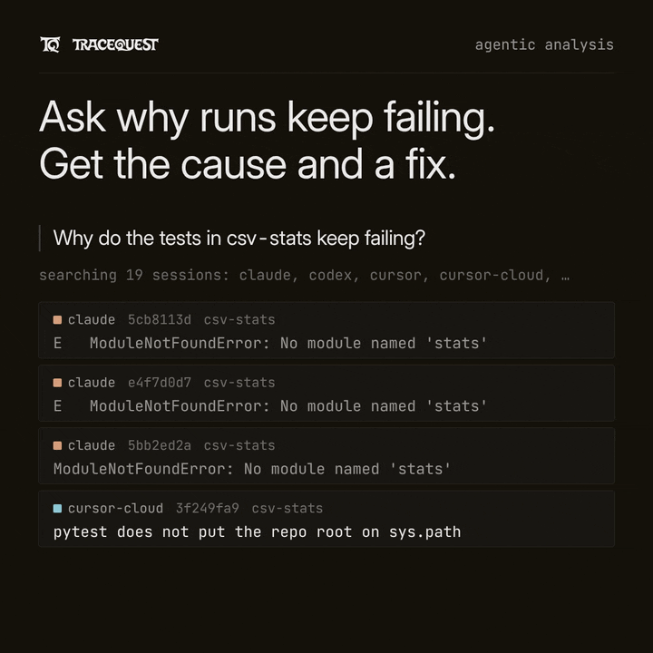</p>

Ask your coding agent why runs in a repo keep failing. With TraceQuest it searches
every agent's past sessions, finds the cause (sometimes another run already worked
it out) and writes the fix into AGENTS.md, so the next run starts with it.

```bash
tracequest search "No module named"   # what your agent runs: every session, every agent
```

### Every coding agent's sessions, in one index

<p align="center">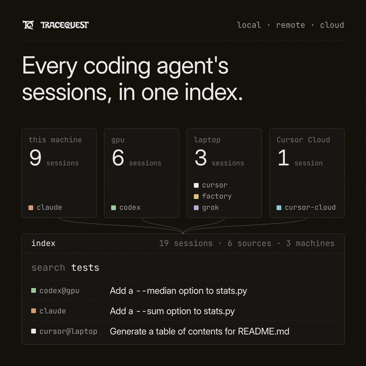</p>

TraceQuest puts every coding agent's sessions in one index: Claude Code, Codex,
Cursor, OpenCode, Grok and Droid, from this machine, your other machines over SSH,
and Cursor Cloud. You can search it, and so can your agents.

```bash
tracequest find "source:codex errors:>0"   # the same filters as the web app
tracequest import ssh gpu                  # copy sessions from another machine
```

<details>
<summary><b>The real screens:</b> the session list and the machines behind it</summary>
<br>
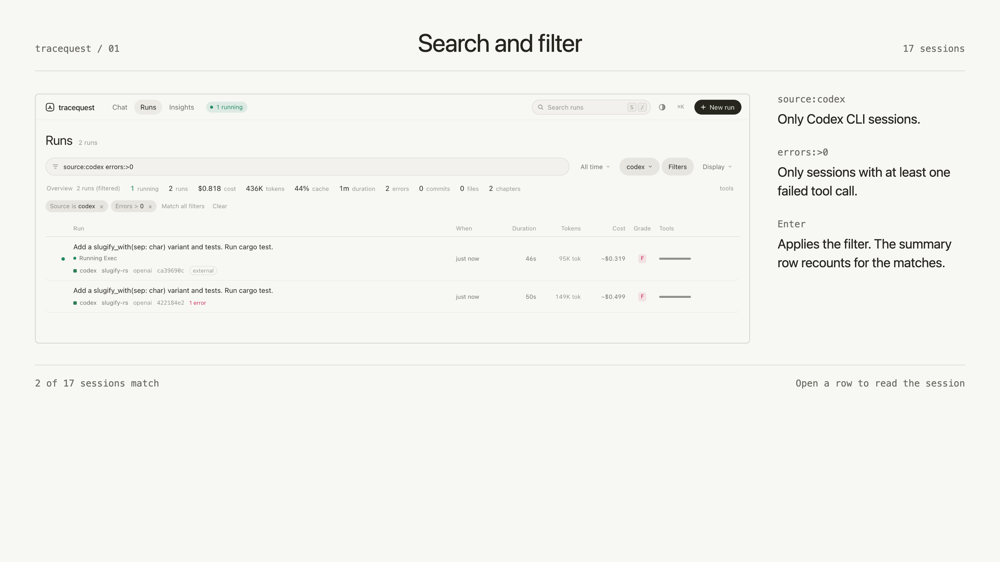
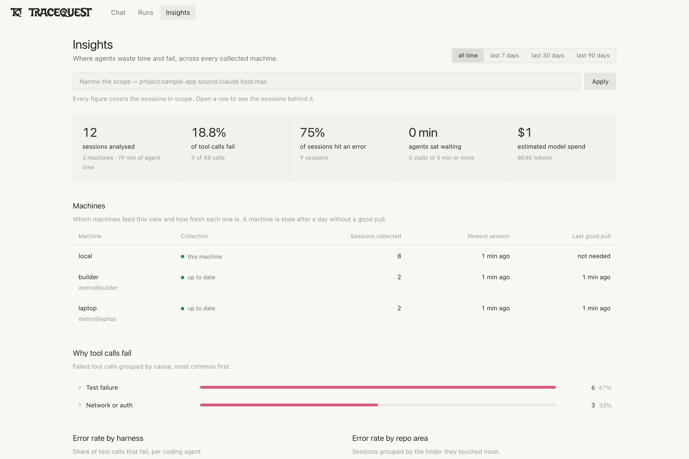
</details>

### What went wrong, and where the time went.

<p align="center">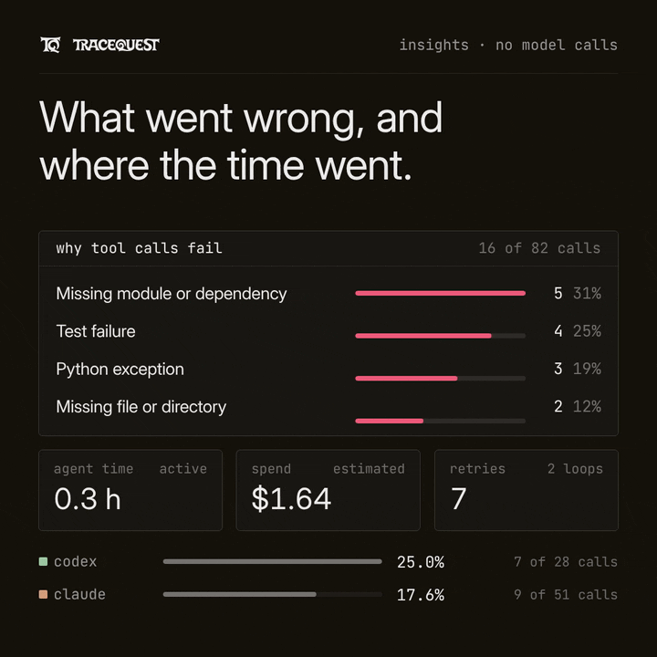</p>

It also keeps the numbers: which failures come up most, error rates per agent,
retries and loops, active time and estimated spend. Narrow it to a project, an
agent, a machine or a time range. It's all computed on your machine, with no
model calls.

```bash
tracequest insights --refresh   # or open /insights in the web app
```

<details>
<summary><b>The real screens:</b> Insights and a single session's report</summary>
<br>
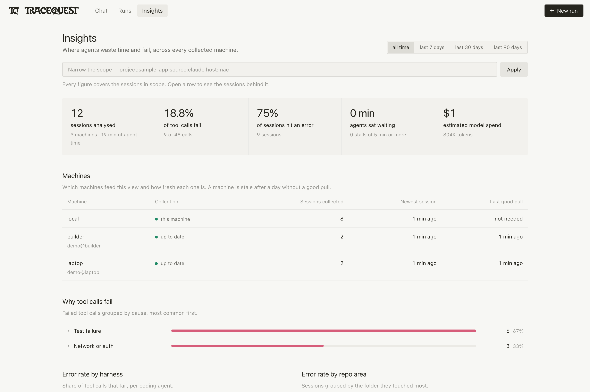
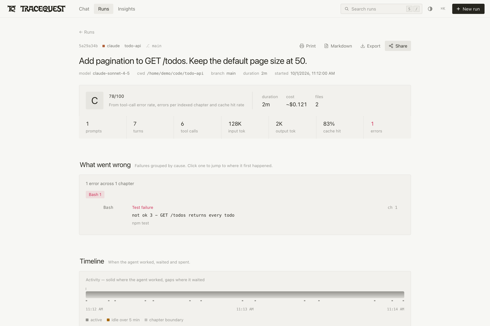
</details>

### Watch runs while they're still going. Steer them from the same place.

<p align="center">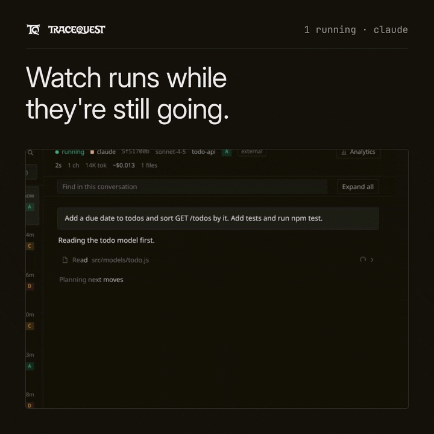</p>

There's an app too. Watch a run while the agent is still working, send follow-ups
to runs you started from it, start a new run in any folder, or continue an earlier
session. Starting and continuing runs needs tmux.

<details>
<summary><b>The real screen:</b> a Codex session in the conversation view</summary>
<br>
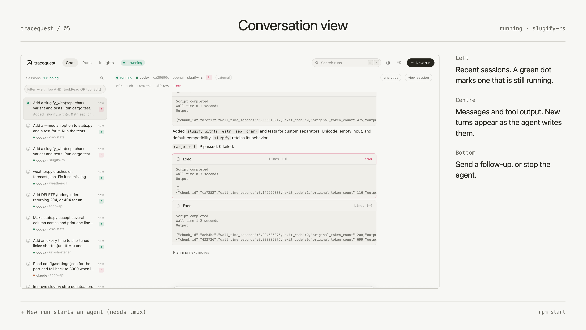
</details>

### Yesterday's standup, written from the sessions.

<p align="center">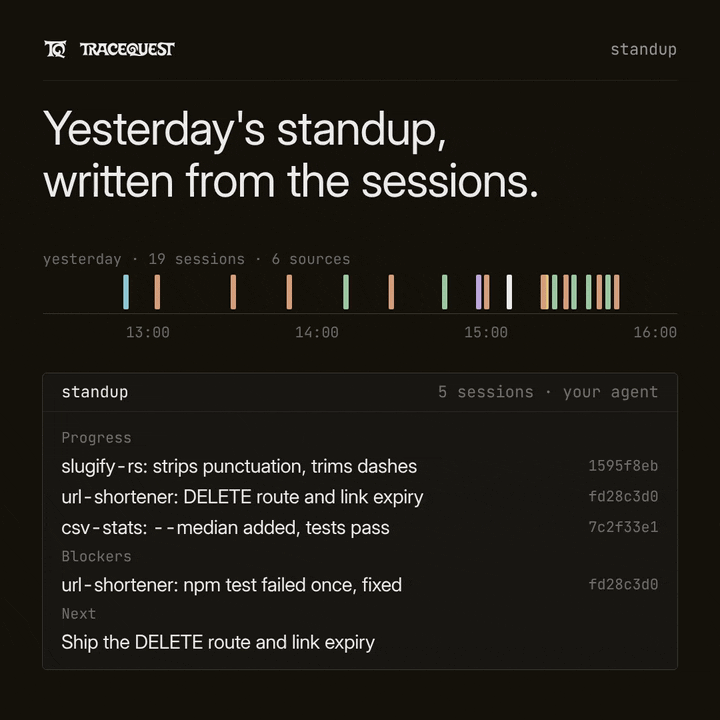</p>

Some things come for free once the sessions are indexed. Yesterday's standup,
written from the sessions by the agent you already use. A handoff that gives a new
run the relevant parts of earlier sessions, with the commands to open each one.

```bash
tracequest standup --yesterday --print-input   # see exactly what the agent will get
tracequest standup --yesterday
tracequest handoff "No module named" --limit 5
```

### And the rest

- **Compare two sessions** side by side: duration, tokens, cache use, errors,
  retries, tool counts and chapter outcomes. Tick two sessions in **All sessions**
  and choose **Compare**. [Screenshot](docs/assets/compare.png)
- **Export and share.** **Export** saves a session as one HTML file with its
  timeline and chapters, **Markdown** saves its text, and `tracequest share`
  publishes to a GitHub Gist or Hugging Face. `tracequest latest --open` opens a
  report for your most recent session. [Screenshot](docs/assets/reports.png)
- **A hub for several machines.** A hub is a read-only TraceQuest server that
  copies sessions from other machines over SSH, hides values that look like
  secrets and rejects changes. Sessions still contain conversation text, so
  restrict who can reach it. [Hub deployment guide](docs/hub-deployment.md)

The clips run on sample sessions written for them; in the first and the standup
clip the agent's replies are acted out. The screenshots use the bundled Claude
Code samples and synthetic Codex recordings, with copies under demo machine
names. Costs are estimated from token counts and model prices. They are not
billing data.

## Try it in a minute

<p align="center">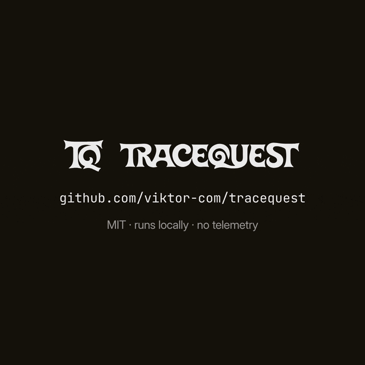</p>

TraceQuest is open source (MIT), runs on your machine and sends no telemetry.
You need **Node.js 22.5 or later** and **git**. No agent account or API key.

```bash
git clone https://github.com/viktor-com/tracequest.git
cd tracequest
npm install
npm run demo
```

Open [localhost:7777](http://localhost:7777). The demo serves two small sample
sessions that ship with the repository.

To see your own sessions, stop the demo with **Ctrl-C** and run:

```bash
npm start   # reads the sessions your agents already wrote
npm link    # optional: puts the tracequest command on your PATH
```

tmux is optional (starting and steering runs); Rust is optional (a faster
indexer). Prebuilt tarballs for macOS arm64 and Linux x64 are attached to each
[release](https://github.com/viktor-com/tracequest/releases).
[Installation, imports and troubleshooting](docs/README.md#start-here).

## Works with

TraceQuest finds sessions where each agent already writes them. There is nothing
to install in the agents.

| Agent | Sessions read from |
| --- | --- |
| Claude Code | `~/.claude/projects/` |
| Codex CLI | `~/.codex/sessions/` |
| Cursor | `~/.cursor/projects/` |
| Cursor Cloud | `tracequest import cursor-cloud` |
| Droid (Factory) | `~/.factory/sessions/` |
| OpenCode | `~/.local/share/opencode/opencode.db` |
| Grok CLI | `~/.grok/sessions/` |
| vktr | `~/.vktr/sessions/` |
| fx | `~/.fx/sessions/` |
| DeepSeek Harness | `~/.dsh/sessions/` |
| Another machine | `tracequest import ssh <host>` |

[Session sources and paths](docs/cli-reference.md#supported-sources).

## Data and network access

Browsing and analysis only read local files. TraceQuest sends no telemetry.
It contacts other services only when you ask it to: sharing a session, importing
remote sessions, or checking plan usage limits. Standup summaries and agent runs
use the agent you have configured.

The server listens on localhost and has no login. Read the
[deployment guide](docs/hub-deployment.md#access) and [security notes](SECURITY.md)
before making it reachable from other machines.

## Documentation

**[Documentation](docs/README.md)**: command reference, configuration, session
locations, live-run API, deployment and development guides. It is written so
that a coding agent can follow it too.

<p align="center">
  <a href="CONTRIBUTING.md">Contribute</a> ·
  <a href="https://github.com/viktor-com/tracequest/issues">Report a bug</a> ·
  <a href="CHANGELOG.md">Changelog</a> ·
  <a href="LICENSE">MIT License</a>
</p>
