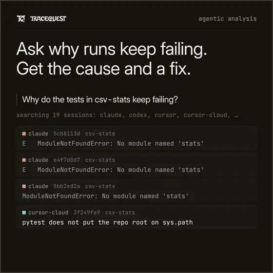
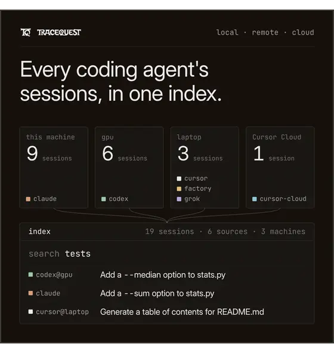
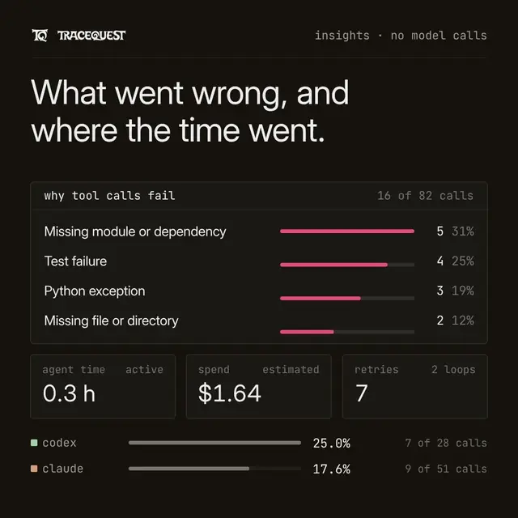
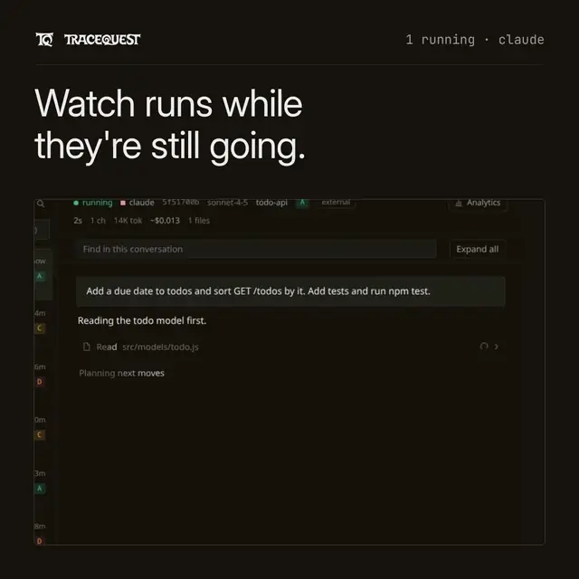
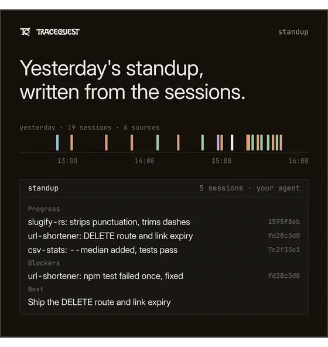

<p align="center">
  <picture>
    <source media="(prefers-color-scheme: dark)" srcset="src/ui/assets/tracequest-wordmark-light.svg">
    
  </picture>
</p>

<h3 align="center">Follow your coding agents. Find what happened.</h3>

<p align="center">A local web app and CLI for the sessions your coding agents already write.</p>

<p align="center">
  <a href="https://cdn.jsdelivr.net/gh/viktor-com/tracequest@450e9275e14cc6729cc7918caa7af4d97f1e2416/docs/assets/launch/tracequest-launch-film.mp4"><picture><source media="(prefers-reduced-motion: reduce)" srcset="docs/assets/launch/hero-poster.jpg"></picture></a>
</p>

<p align="center">
  <a href="#try-it-in-a-minute"><picture><source media="(prefers-color-scheme: dark)" srcset="docs/assets/launch/try-dark.svg"></picture></a>&nbsp;&nbsp;
  <a href="https://cdn.jsdelivr.net/gh/viktor-com/tracequest@450e9275e14cc6729cc7918caa7af4d97f1e2416/docs/assets/launch/tracequest-launch-film.mp4"><picture><source media="(prefers-color-scheme: dark)" srcset="docs/assets/launch/film-dark.svg"></picture></a>
</p>

<p align="center"><sub>Claude Code · Codex · Cursor · Droid · OpenCode · Grok · vktr · fx · DeepSeek Harness<br>MIT · runs on your machine · no telemetry · no account</sub></p>

## What it does



### Agentic analysis

Ask your coding agent why runs in a repo keep failing. With TraceQuest it searches
every agent's past sessions, finds the cause (sometimes another run already worked
it out) and writes the fix into AGENTS.md, so the next run starts with it.

```bash
tracequest search "No module named"
```

<br clear="right">



### One index

TraceQuest puts every coding agent's sessions in one index: Claude Code, Codex,
Cursor, OpenCode, Grok and Droid, from this machine, your other machines over SSH,
and Cursor Cloud. You can search it, and so can your agents.

```bash
tracequest find "errors:>0"
tracequest import ssh gpu
```

<br clear="left">



### Insights

It also keeps the numbers: which failures come up most, error rates per agent,
retries and loops, active time and estimated spend. Narrow it to a project, an
agent, a machine or a time range. It's all computed on your machine, with no
model calls.

```bash
tracequest insights --refresh
```

<br clear="right">



### The app

There's an app too. Watch a run while the agent is still working, send follow-ups
to runs you started from it, start a new run in any folder, or continue an earlier
session. Run `npm start` and open localhost:7777; starting and continuing runs
needs tmux.

<br clear="left">



### What falls out

Some things come for free once the sessions are indexed. Yesterday's standup,
written from the sessions by the agent you already use. A handoff that gives a new
run the relevant parts of earlier sessions, with the commands to open each one.

```bash
tracequest standup --yesterday
tracequest handoff "No module"
```

<br clear="right">

**Also in the box**

- [Compare two sessions](docs/assets/compare.png) side by side
- Export a session as [one HTML report](docs/assets/reports.png) or Markdown, or share it to a Gist or Hugging Face
- A read-only [hub](docs/hub-deployment.md) that collects sessions from your machines over SSH

<sub>The clips run on sample sessions written for them; in the analysis and standup
clips the agent's replies are acted out. Costs are estimated from token counts and
model prices, not billing data.</sub>

## Try it in a minute

TraceQuest is open source (MIT), runs on your machine and sends no telemetry.
You need **Node.js 22.5+** and **git**. Paste this into your coding agent, in
the project you want to look into:

```text
Add the TraceQuest skill to this project and use it.
1. Clone https://github.com/viktor-com/tracequest.git next to this project (../tracequest).
2. Copy ../tracequest/skills/tracequest into this project's skills folder
   (.claude/skills/tracequest for Claude Code, or your agent's own skills folder).
3. Follow that SKILL.md: install TraceQuest, then find out what keeps failing in this
   project's past agent sessions and propose a fix for AGENTS.md.
```

To browse it yourself instead, run `npm run demo` in the clone and open
[localhost:7777](http://localhost:7777) for two bundled sample sessions, or
`npm start` for your own.

<details>
<summary><b>Where TraceQuest finds each agent's sessions</b></summary>
<br>

| Agent | Sessions read from |
| --- | --- |
| Claude Code | `~/.claude/projects/` |
| Codex CLI | `~/.codex/sessions/` |
| Cursor | `~/.cursor/projects/` |
| Cursor Cloud | `tracequest import cursor-cloud` |
| Droid (Factory) | `~/.factory/sessions/` |
| OpenCode | `~/.local/share/opencode/opencode.db` |
| Grok CLI | `~/.grok/sessions/` |
| vktr (Viktor's fork of the Grok CLI) | `~/.vktr/sessions/` |
| fx (Vercel's coding agent) | `~/.fx/sessions/` |
| DeepSeek Harness | `~/.dsh/sessions/` |
| Another machine | `tracequest import ssh <host>` |

Nothing to install in the agents. tmux (runs) and Rust (a faster indexer) are
optional; prebuilt tarballs for macOS arm64 and Linux x64 are on each
[release](https://github.com/viktor-com/tracequest/releases).
[Installation, imports and troubleshooting](docs/README.md#start-here) ·
[sources and paths](docs/cli-reference.md#supported-sources).
</details>

<details>
<summary><b>Data and network access</b></summary>
<br>

Browsing and analysis only read local files. TraceQuest sends no telemetry.
It contacts other services only when you ask it to: sharing a session, importing
remote sessions, or checking plan usage limits. Standup summaries and agent runs
use the agent you have configured.

The server listens on localhost and has no login. Read the
[deployment guide](docs/hub-deployment.md#access) and [security notes](SECURITY.md)
before making it reachable from other machines.
</details>

<p align="center">
  <a href="docs/README.md"><b>Documentation</b></a> ·
  <a href="CONTRIBUTING.md">Contributing</a> ·
  <a href="CHANGELOG.md">Changelog</a> ·
  <a href="LICENSE">MIT</a>
</p>
