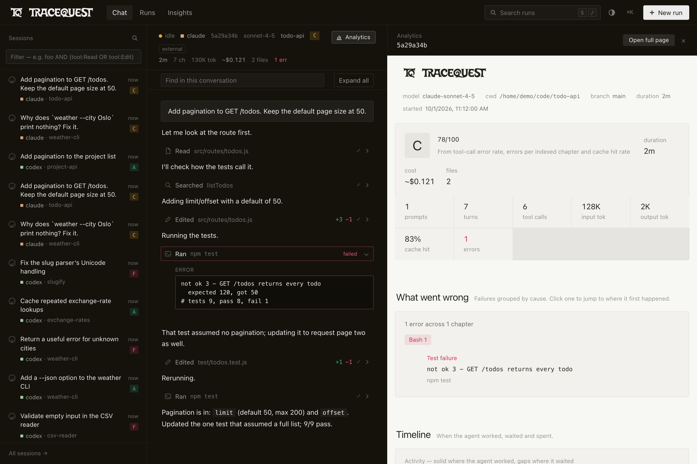

<p align="center">
  
</p>
<h1 align="center">
  <picture>
    <source media="(prefers-color-scheme: dark)" srcset="src/ui/assets/tracequest-wordmark-light.svg">
    
  </picture>
</h1>

<p align="center">Follow your coding agents. Find what happened.</p>

<p align="center">
  <a href="https://cdn.jsdelivr.net/gh/viktor-com/tracequest@450e9275e14cc6729cc7918caa7af4d97f1e2416/docs/assets/launch/tracequest-launch-film.mp4"></a>
</p>

<p align="center">
  <a href="https://cdn.jsdelivr.net/gh/viktor-com/tracequest@450e9275e14cc6729cc7918caa7af4d97f1e2416/docs/assets/launch/tracequest-launch-film.mp4"><picture>
    <source media="(prefers-color-scheme: dark)" srcset="docs/assets/launch/watch-film-dark.svg">
    
  </picture></a>
</p>

<p align="center">
  <a href="#try-it-in-a-minute"><b>Try it in a minute</b></a> ·
  <a href="#what-it-does">What it does</a> ·
  <a href="#works-with">Works with</a> ·
  <a href="docs/README.md">Documentation</a>
</p>

Your coding agents already write down everything they do: every prompt, command,
error, wait and token. TraceQuest reads those session files and shows you what
happened. It is a local web app and CLI for Claude Code, Codex CLI, Cursor,
Droid (Factory), OpenCode, Grok CLI, vktr (Viktor's fork of the Grok CLI),
fx (Vercel's coding agent) and DeepSeek Harness. It runs on your machine, needs
no account and sends no telemetry.

## What it does

The commands below assume `tracequest` is on your PATH (`npm link` in the clone, see
[Try it in a minute](#try-it-in-a-minute)). `node bin/tracequest.js` works too.

### Every coding agent's sessions, in one index

<p align="center"></p>

Sessions from this machine, from other machines (copied over SSH) and from Cursor
Cloud Agents land in one list. Search the message text, or filter by project,
agent, machine, model, tool, error count and age. The summary row shows totals for
whatever matches.

```bash
tracequest search "No module named"      # full-text search across every agent
tracequest find "source:codex errors:>0" # the same filters as the web app
```

<details>
<summary><b>The real screens:</b> the session list and the multi-machine hub</summary>
<br>


</details>

### Ask why runs keep failing. Get the cause and a fix.

<p align="center"></p>

Your agents can search TraceQuest too. Ask your coding agent why something keeps
breaking: it runs `tracequest search`, finds the same error across every session
and every agent, and can write the fix into AGENTS.md so the next run starts with
it. `handoff` prints the matches as Markdown made for a prompt. It uses the local
index only, with no model calls.

```bash
tracequest handoff "No module named" --limit 5
```

<details>
<summary><b>Real output</b> from the demo sessions: <code>tracequest handoff "not ok" --limit 3</code></summary>

```markdown
# TraceQuest Search Handoff

- Query: `not ok`
- Sort: `relevance`
- Results: 1
- Privacy: includes session hashes, metadata, and capped TraceQuest search snippets; no full transcripts or absolute paths.

## Follow-up Commands

- Refresh this handoff: `tracequest handoff 'not ok' --limit 3`

## Matches

1. Session `5150abde`
   - Date: `2026-10-22 20:52`
   - Source: `claude`
   - Project: `todo-api`
   - First prompt: `Add pagination to GET /todos. Keep the default page size at 50.`
   - Snippets:
     - `match`: `...use_id": "toolu_0b6f7c_04", "content": "not ok 3 - GET /todos returns every todo expected 120, got 5...`
     - `match`: `...t": [{"type": "text", "text": "Let me look at the route first."}, {"type": "tool_use", "id": "toolu_0b...`
   - Commands:
     - `tracequest render 5150abde`
     - `tracequest messages 5150abde --pretty`
```
</details>

### What went wrong, and where the time went.

<p align="center"></p>

Insights groups failed tool calls by cause. It also shows error rates per agent,
retries, loops, active time and estimated cost. Expand a cause to see the failed
output and a link to the session it came from. Each session also gets a timeline
of when the agent worked and waited, a token chart per turn, and chapters that
list each prompt, the commands it led to, their output and any retries. The analysis runs
on your machine and makes no model calls.

```bash
tracequest insights --refresh   # or open /insights in the web app
```

<details>
<summary><b>The real screens:</b> Insights and a session's timeline</summary>
<br>


</details>

### Watch runs while they're still going. Steer them from the same place.

<p align="center"></p>

The conversation view updates while the agent is still working. **+ New run**
starts an installed agent in a directory you choose. You can send follow-up
messages to runs started from TraceQuest and continue supported sessions as a new
run. Runs live in tmux, so `tmux attach -t tracequest` shows the same runs in a
terminal. Starting and continuing runs needs tmux.

<details>
<summary><b>The real screen:</b> a Codex session in the conversation view</summary>
<br>

</details>

### Yesterday's standup, written from the sessions.

<p align="center"></p>

`standup` summarises recent sessions as progress, blockers and next steps, using
an agent you already have: Claude Code, Codex or Droid is detected for you. Run
it with `--print-input` first to see exactly what would be sent: session
metadata, counts and short chapter notes, never full transcripts.

```bash
tracequest standup --yesterday --print-input   # what the agent would see
tracequest standup --yesterday
```

### And the rest

- **Compare two sessions** side by side: duration, tokens, cache use, errors,
  retries, tool counts and chapter outcomes. Tick two sessions in **All sessions**
  and choose **Compare**. [Screenshot](docs/assets/compare.png)
- **Export and share.** **Export** saves a session as one HTML file with its
  timeline and chapters, **Markdown** saves its text, and `tracequest share`
  publishes to a GitHub Gist or Hugging Face. `tracequest latest --open` opens a
  report for your most recent session. [Screenshot](docs/assets/reports.png)
- **Collect sessions from several machines.** A hub is a read-only TraceQuest
  server that copies sessions from other machines over SSH, hides values that look
  like secrets and rejects changes. Sessions still contain conversation text, so
  restrict who can reach it. [Hub deployment guide](docs/hub-deployment.md)

The screenshots use the bundled Claude Code samples and synthetic Codex
recordings; the hub shows copies under demo machine names. Costs are estimated
from token counts and model prices. They are not billing data.

## Try it in a minute

You need **Node.js 22.5 or later** and **git**. No agent account or API key.

```bash
git clone https://github.com/viktor-com/tracequest.git
cd tracequest
npm install
npm run demo
```

Open [localhost:7777](http://localhost:7777). The demo serves two small sample
sessions that ship with the repository.

<p align="center"></p>

To see your own sessions, stop the demo with **Ctrl-C** and run:

```bash
npm start   # reads the sessions your agents already wrote
npm link    # optional: puts the tracequest command on your PATH
```

tmux is optional (starting and steering runs); Rust is optional (a faster
indexer). Prebuilt tarballs for macOS arm64 and Linux x64 are attached to each
[release](https://github.com/viktor-com/tracequest/releases).
[Installation, imports and troubleshooting](docs/README.md#start-here).

## Works with

TraceQuest finds sessions where each agent already writes them. There is nothing
to install in the agents.

| Agent | Sessions read from |
| --- | --- |
| Claude Code | `~/.claude/projects/` |
| Codex CLI | `~/.codex/sessions/` |
| Cursor | `~/.cursor/projects/` |
| Cursor Cloud Agents | `tracequest import cursor-cloud` |
| Droid (Factory) | `~/.factory/sessions/` |
| OpenCode | `~/.local/share/opencode/opencode.db` |
| Grok CLI | `~/.grok/sessions/` |
| vktr (Viktor's fork of the Grok CLI) | `~/.vktr/sessions/` |
| fx (Vercel's coding agent) | `~/.fx/sessions/` |
| DeepSeek Harness | `~/.dsh/sessions/` |
| Any of these on another machine | `tracequest import ssh` |

[Session sources and paths](docs/cli-reference.md#supported-sources).

## Data and network access

Browsing and analysis only read local files. TraceQuest sends no telemetry.
It contacts other services only when you ask it to: sharing a session, importing
remote sessions, or checking plan usage limits. Standup summaries and agent runs
use the agent you have configured.

The server listens on localhost and has no login. Read the
[deployment guide](docs/hub-deployment.md#access) and [security notes](SECURITY.md)
before making it reachable from other machines.

## Documentation

**[Documentation](docs/README.md)**: command reference, configuration, session
locations, live-run API, deployment and development guides. It is written so
that a coding agent can follow it too.

<p align="center">
  <a href="https://cdn.jsdelivr.net/gh/viktor-com/tracequest@450e9275e14cc6729cc7918caa7af4d97f1e2416/docs/assets/launch/tracequest-launch-film.mp4"></a>
</p>

<p align="center">
  <a href="CONTRIBUTING.md">Contribute</a> ·
  <a href="https://github.com/viktor-com/tracequest/issues">Report a bug</a> ·
  <a href="CHANGELOG.md">Changelog</a> ·
  <a href="LICENSE">MIT License</a>
</p>
