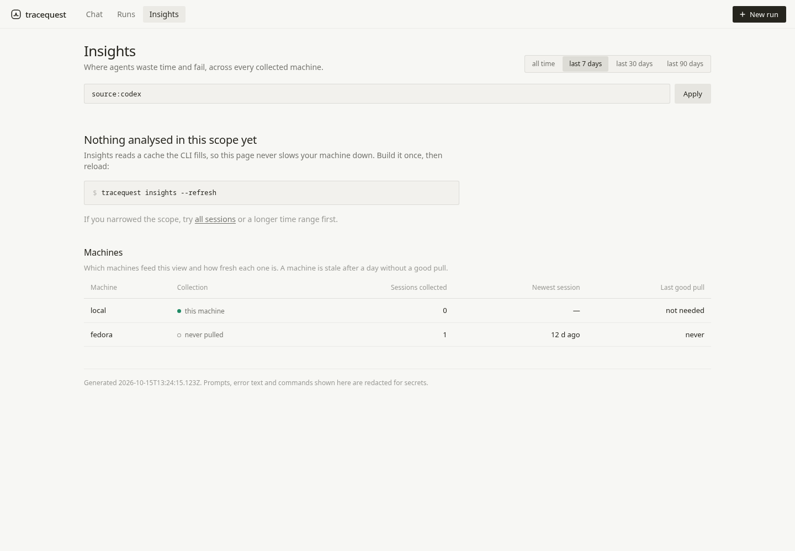
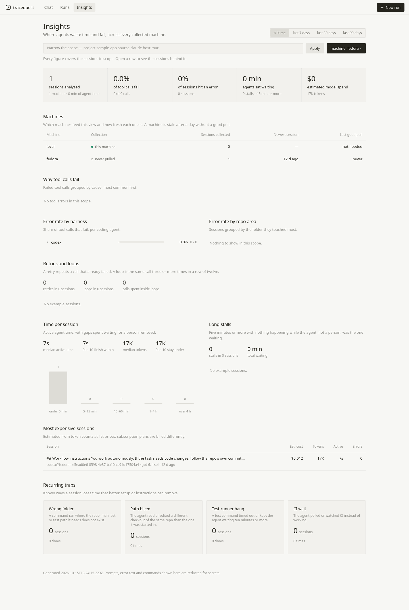
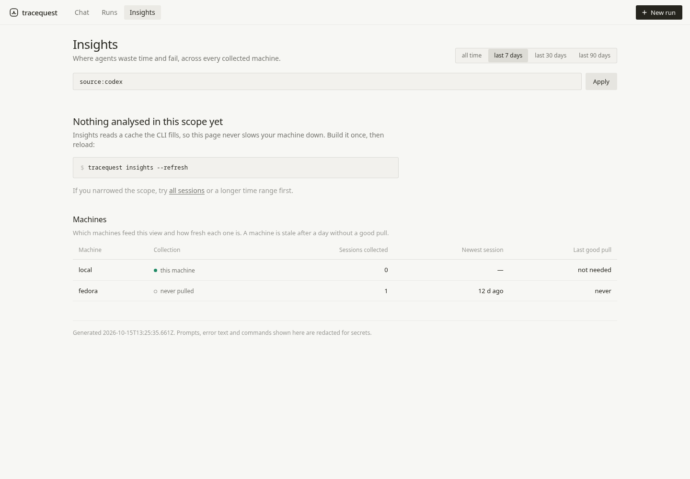
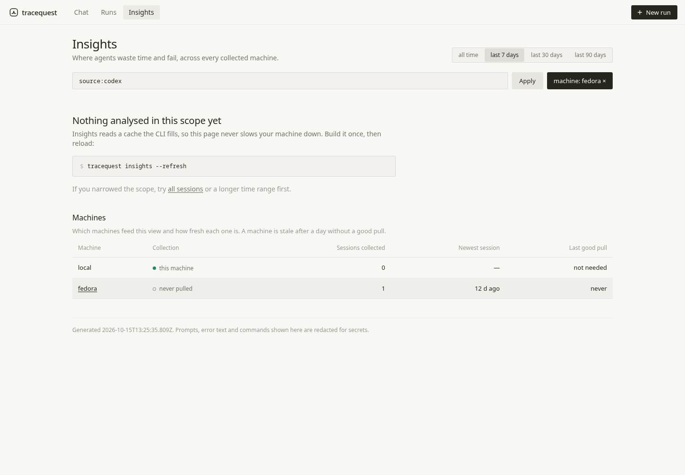

# Insights machine scope: finding 8 proof

Baseline: current GitHub origin/main `636d4d2d144208bac976bc77653f94254cd287d6` (0.4.0), verified via GitHub branch API on 15 October 2026. The audit brief expected a newer main; this is the actual current canonical main.

A byte-identical real Fedora Codex recording from 3 October was copied with its original timestamps into a disposable HOME. SHA-256: `7789ada9b795b07ba7da4bb63c3c25c212bb791942205672ecaf9d31e70ce8e1`. The real recording is deliberately not uploaded. Direct SSH and hub API access to the Mac timed out; the equivalent real recording permitted by Acceptance was used instead. No original recording was changed.

Real browser, actual `tracequest serve`, loopback port 18088, isolated tmux socket/session, no sidecar and no metered services. Browser console errors: none. Browser script: [browser-proof.mjs](browser-proof.mjs). Exact URL/control/result snapshots: [main.json](main.json), [branch.json](branch.json).

- Main: `?expr=source%3Acodex&days=7` becomes `?host=fedora`; source field clears, selected range becomes all time, 0 analysed sessions becomes 1 (the older recording leaks into the scope).
- Branch: same start becomes `?expr=source%3Acodex&days=7&host=fedora`; source field stays source:codex, selected range stays last 7 days, and the older recording stays excluded (0 analysed sessions).

| | Before clicking Fedora | After clicking Fedora |
|---|---|---|
| Current main |  |  |
| Fixed branch |  |  |

The new served-browser regression test fails on main at the lost-source assertion and passes on the fixed branch with no skips: [main test](test-main.txt), [branch test](test-branch.txt). It checks UI and API session counts with recent Codex recordings on Fedora/Mac/local, an older Fedora Codex recording, and a recent Fedora Claude recording. Selecting/switching/clearing machines, source-only, time-only and unfiltered navigation are covered.

Evidence is kept on a separate branch so the fix PR contains only the three-line production change, one new browser test and its fact. Final merge validation uses targeted local tests and independent review, per Ivan’s revised gate. CI remains intentionally unused.

## Independent review and merge gate

Fresh-context reviewer: **PASS**, no actionable findings. [Complete review](review.md), [12 independent real-recording browser checkpoints](review-browser-results.json), [run output](review-browser-run.log), [reproduction script](review-reproduce.mjs). The independent reviewer used a separate disposable HOME and random port, checked source/time preservation, count correctness, switching/clearing, reload, empty scope, mobile light/dark themes and encoded expressions. No page errors; reviewer service/browser stopped and HOME removed.

## Final outcome: DONE

[PR #23](https://github.com/viktor-com/tracequest/pull/23) merged as [`ebac5de220d1a4616c7aeab6723a65172cf3bf6d`](https://github.com/viktor-com/tracequest/commit/ebac5de220d1a4616c7aeab6723a65172cf3bf6d). [Merge verification](merge-result.json). Ivan confirmed CI is intentionally disabled and replaced the CI prerequisite with targeted tests on current main plus the independent reviewer pass. No workflow was enabled or dispatched, and no settings or workflow files changed.

Sibling fixes moved main repeatedly; the branch was rebased and the targeted test rerun after each move. Final tested main `70a29b0b960cfa5008b7dcec778eabc83faa6089` is exactly the merged commit's parent. [Final targeted test output](final-targeted-tests.txt): **1 passed, 0 failed, 0 manual**, using `nice -n 19 taskset -c 0-3 facts check --tags insights-machine-scope`. No rebase conflicts or code changes were needed. The complete final merged diff was reviewed; it remains exactly the renderer change, new browser test and fact. No existing tests/config changed, no abandoned/reverted hunks, and no dependencies.

All Acceptance lines are met under the revised gate: reproduction and real-browser proof above; one narrow PR merged; failing/passing regression; fresh-context independent review PASS; targeted test passed on current main; isolated scratch work with cleanup and unchanged originals; completed within one day. No release or deploy. Scratch services and browsers stopped; disposable HOME removed. Metered spend: $0.
